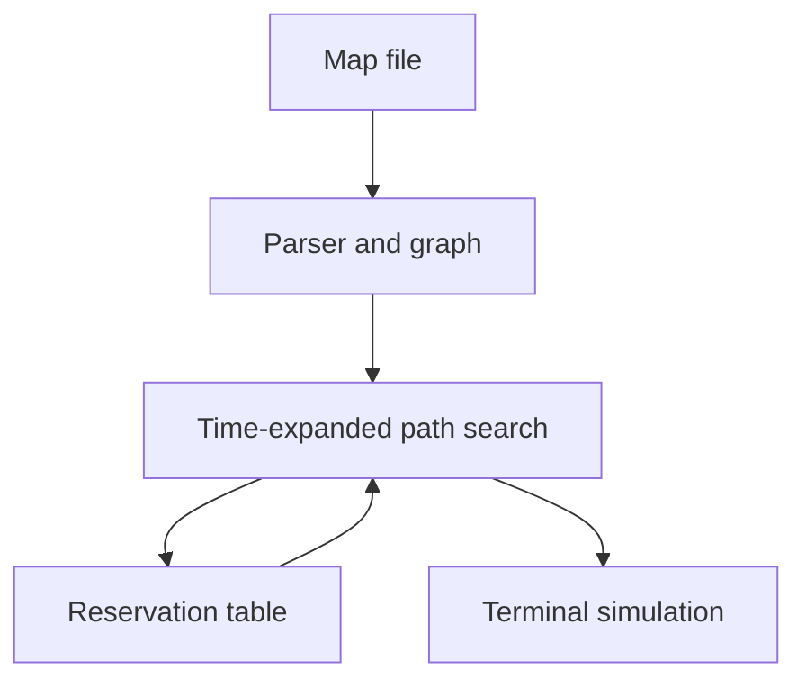

# Fly-in

A Python multi-drone pathfinding simulator that plans routes through a graph while respecting time-indexed zone and connection capacities.

This educational project explores how finding a path changes when other agents have already reserved parts of the network.

## Run locally

The simulator uses Python’s standard library and requires Python 3.10 or later.

```bash
git clone https://github.com/ahmedaitelaaoud/Fly-in.git
cd Fly-in
python3 -m src maps/easy/01_linear_path.txt
```

For the uv-managed development environment:

```bash
uv sync
make run MAP=maps/easy/01_linear_path.txt
uv run mypy src
uv run flake8 src
```

The easy linear example routes two drones through two intermediate hubs and finishes in four turns. The terminal view shows movement commands and hub occupancy.

## How it works



The program plans drones sequentially. For each drone, a heap-based search explores states identified by **zone and turn**. A drone may move to a neighboring zone or wait for one turn. Arrival time drives the search order, with priority zones used as a tie-breaker.

After finding a route, the program reserves its zone visits and connection usage before planning the next drone. Connection keys are direction-independent, so both directions share capacity. Start and end zones are treated as having unlimited occupancy.

## Map format

```text
nb_drones: 2
start_hub: start 0 0 [color=green]
hub: waypoint1 1 0 [color=blue]
hub: waypoint2 2 0 [color=blue]
end_hub: goal 3 0 [color=red]
connection: start-waypoint1
connection: waypoint1-waypoint2
connection: waypoint2-goal
```

See [maps/README.md](maps/README.md) and the easy, medium, hard, and challenger directories for additional inputs.

## Code map

| Directory | Responsibility |
| --- | --- |
| `src/parser/` | Map parsing and input validation |
| `src/models/` | Zones, connections, and drone models |
| `src/graph/` | Adjacency and connection lookup |
| `src/pathfinding/` | Reservation-aware path search |
| `src/simulation/` | Zone and connection reservation tables |
| `src/visualization/` | ANSI terminal output |

## Trade-offs and limitations

- Sequential planning is easier to inspect than a joint search over all agents, but ordering affects later drones. It does not guarantee a globally optimal schedule.
- Search has a fixed horizon of `2 × number_of_zones × number_of_drones`; some feasible routes can be missed.
- If one drone has no route, the program reports it and continues. A displayed simulation can therefore contain fewer drones than requested.
- The repository contains map fixtures, but no automated assertions for collision freedom, capacities, or completeness.
- The linear example has been smoke-tested; the full map collection has not been validated by that check.

Next steps: automate capacity checks over produced routes, test disconnected graphs and waits, and make the planning horizon configurable.

## License

No repository-level license is currently included.

